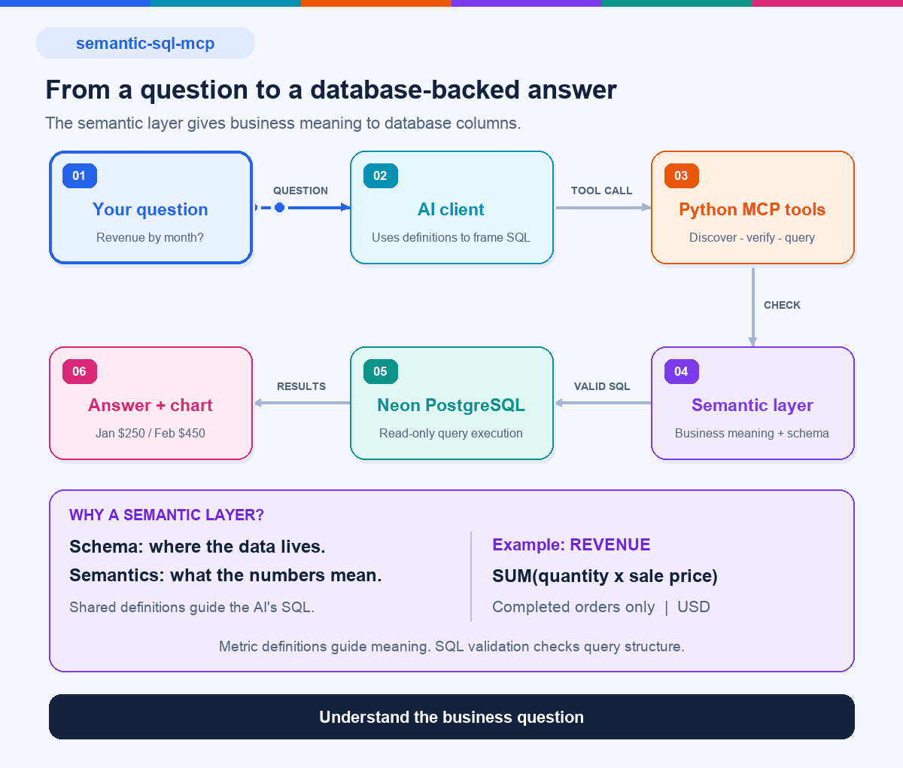
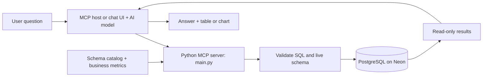

# semantic-sql-mcp

Ask business questions against PostgreSQL through a Python MCP server, with
an explicit schema catalog and business metric definitions. Includes synthetic
sales data and an optional Streamlit AI chat UI.

## Architecture



[Static image](docs/architecture.png). Regenerate with
`python scripts/render_architecture.py` (requires Pillow).



The AI reads the catalog, generates SQL and calls MCP tools. The server verifies
schema and query structure before executing SQL with a read-only login. Metric
definitions guide the model; the validator does not guarantee the business
meaning of every generated query. This implementation targets PostgreSQL; other
databases need adapted drivers, catalogs, SQL validation and permissions.

## Quick start

Requires Python 3.12 and a PostgreSQL database (the demo uses Neon).

```sh
git clone https://github.com/ramprasadowk/semantic-sql-mcp.git
cd semantic-sql-mcp
python3.12 -m venv .venv-mcp
.venv-mcp/bin/python -m pip install -r requirements.lock
cp .env.example .env.local
```

Edit `.env.local` locally with your own pooled and direct database URLs.
Do not paste credentials into chat. Then create the sample schema and reader:

```sh
.venv-mcp/bin/python scripts/setup_database.py
.venv-mcp/bin/python scripts/create_readonly_user.py
.venv-mcp/bin/python demo.py
```

The setup script creates four tables in `sales_demo`, plus
`public.mcp_demo_migrations` to track the migration checksum. Existing
conflicting tables cause a rollback rather than replacement. Rerunning skips
an applied migration and verifies its expected seed results. The reader script
creates `sales_mcp_reader` and adds `MCP_DATABASE_URL` privately to `.env.local`.
It preserves existing settings and refuses to rotate an existing role silently.

## Run the MCP server

```sh
.venv-mcp/bin/python main.py --transport streamable-http
```

MCP endpoint: `http://127.0.0.1:8000/mcp`. Open it with an MCP client, not a
browser tab. For local stdio clients, configure the absolute path to
`.venv-mcp/bin/python` as the command and the absolute path to `main.py` as its
argument. No HTTP server or tunnel is needed for stdio.

| Tool | Purpose |
| --- | --- |
| `get_catalog` | Return verified tables, columns, relationships and metrics |
| `verify_schema` | Compare expected columns, types, keys and relationships with the live database |
| `run_readonly_query` | Validate and execute one SELECT against allowed tables |

## Optional chat UI

Add your own `OPENAI_API_KEY` to `.env.local`. API billing is separate from a
ChatGPT subscription. `OPENAI_MODEL` optionally overrides `gpt-4.1-mini`.

```sh
.venv-mcp/bin/python -m streamlit run app.py
```

Open http://localhost:8501. The app starts the MCP server over stdio automatically.
It shows answers, tables, SQL/tool activity, and charts for recognized date/metric
columns. Conversation text, schema context and query results are sent to OpenAI;
API keys and database credentials are not included in tool arguments. Responses
use `store=False`; provider data policies still apply. Conversation history stays
in the browser's Streamlit session and can be cleared.

The live OpenAI test hit a quota/rate-limit error in the development account.
The full AI-to-database chat flow remains unverified until API access succeeds.
The MCP/database flow and offline model-loop tests pass. UI verification is outside this check.

## Demo questions

- What is our revenue by month?
- Which region has the highest revenue?
- What is our average order value?

Synthetic data: 3 customers, 3 products, 6 orders, 8 line items. Revenue is
`SUM(quantity * order_items.unit_price)` for completed orders only, in USD.
Expected: January 2026 **$250**, February **$450**, total **$700**, 4 completed
orders, average order value **$175**. Pending and cancelled orders are excluded.

## Tests

```sh
# Offline SQL validation and model-loop tests; no API charges
.venv-mcp/bin/python -m unittest discover -s tests -v
# Real MCP + Neon tests; no OpenAI API calls
.venv-mcp/bin/python scripts/test_mcp.py
.venv-mcp/bin/python scripts/test_mcp.py --http
```

## Files

```text
main.py                     MCP entry point
app.py                      Streamlit chat UI
chat_backend.py             OpenAI function-calling loop + local MCP client
db.py                       Read-only Neon connection
tools/                      Catalog and SQL tools
catalog/                    Schema relationships and metric definitions
sql/                        Versioned synthetic sales migration
scripts/                    Setup, reader provisioning and MCP verification
tests/                      SQL validation and model-loop regression tests
.env.example                Placeholders only; copy to .env.local
```

SQL execution is deliberately restricted: one SELECT, catalogued tables and
columns, explicit JOIN ON, simple aggregates and DATE_TRUNC. CTEs, subqueries,
casts, arbitrary functions, stars and writes are rejected. Results are capped
at 200 rows with explicit truncation; query timeout is 5 seconds. Monetary
values are returned as strings to preserve precision. Each query rechecks the
live schema. The app binds to localhost; add authentication before remote hosting.

## Sharing this repository

`.gitignore` excludes real env files, Neon project links, virtual environments,
installed packages, caches, logs, key files and local editor settings. Optional
Node/Neon CLI scaffolding stays local; it is not needed by the Python project.
Only `.env.example` contains public configuration placeholders.
Before each commit, run the credential check and review staged files:

```sh
.venv-mcp/bin/python scripts/check_public_files.py
git diff --cached --check
git diff --cached --stat
```

The checker scans staged contents and publishable working files for known local
credentials, API-key patterns and credential-bearing database URLs. It prints
filenames only for findings. It cannot guarantee detection of every secret.

Review staged files before committing. If a real secret was ever committed,
ignoring it afterward is insufficient: rotate it and remove it from history.
